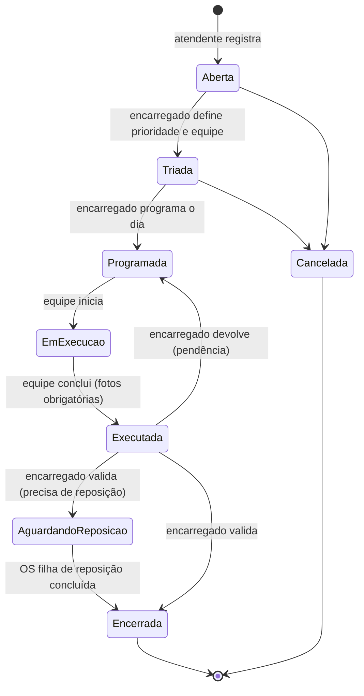

# Especificação do MVP: Ordens de Serviço

> Versão de 19/11/2026.

## Objetivo

Substituir o papel e o WhatsApp por um fluxo único de Ordens de Serviço, do pedido do morador até a reposição do pavimento, com cada OS localizada no mapa.

| Falha comum nas autarquias | Resposta no MVP |
| --- | --- |
| Reposição pós-reparo esquecida ou malfeita | A OS só se encerra quando a reposição é concluída; reposições pendentes têm fila própria |
| Sem fotos | Foto de antes e depois obrigatórias para concluir a execução |
| Cadastro de redes não alimentado | Equipe registra diâmetro, material, profundidade e pavimento no local |
| Peças sem controle | Lista de peças e quantidades por OS (sem estoque ainda) |

**Critério de sucesso do piloto:** em três meses, toda OS do município passa pelo Jusante, com foto, local e peças registradas.

## Premissas (confirmadas)

| Tema | Premissa |
| --- | --- |
| Internet em campo | App funciona sem sinal e sincroniza depois |
| Integração | MVP funciona sozinho, sem sistema comercial |
| Mapa base | OpenStreetMap + importação opcional de redes (GeoPackage/Shapefile) |
| Aparelhos | Celular Android comum |
| Equipe | Poucas pessoas acumulando papéis |

## Ciclo de vida da OS

Cancelamento só antes da programação, sempre com justificativa.

Quando a equipe indica que o serviço precisa de reposição, o encarregado valida a execução e o sistema abre automaticamente uma OS filha do tipo "Reposição de pavimento". A OS de origem fica "Aguardando reposição" e se encerra sozinha quando a filha for encerrada.

## Perfis

| Perfil | Pode fazer |
| --- | --- |
| Atendente | Abrir OS, consultar histórico por endereço, informar o morador |
| Encarregado | Tudo do atendente + triar, programar, validar, encerrar, reabrir |
| Equipe de campo | Ver OS do dia, executar, registrar fotos, peças, cadastro e reposição |
| Gestor | Ver painel, mapa e relatórios; não altera OS |

Uma pessoa pode acumular perfis. Toda alteração fica no histórico da OS.

## Tipos de OS iniciais

| Tipo | Sistema | Prioridade sugerida | Gera reposição? |
| --- | --- | --- | --- |
| Vazamento na rede | Água | Alta | Sim |
| Vazamento no ramal / cavalete | Água | Alta | Às vezes |
| Falta d'água | Água | Alta | Não |
| Ligação nova de água | Água | Normal | Sim |
| Corte / religação | Água | Normal | Não |
| Troca de hidrômetro | Água | Baixa | Não |
| Desobstrução de rede ou ramal de esgoto | Esgoto | Alta | Às vezes |
| Extravasamento de PV / esgoto a céu aberto | Esgoto | Alta | Às vezes |
| Ligação nova de esgoto | Esgoto | Normal | Sim |
| Reposição de pavimento / calçada | Apoio | Normal | — |

## Registro em campo

| Item | Obrigatório? |
| --- | --- |
| Localização real (GPS + ajuste no mapa) | Sim |
| Foto antes / foto depois (com data, hora e coordenada) | Sim |
| O que foi encontrado (lista + observação) | Sim |
| O que foi feito (lista + observação) | Sim |
| Precisa de reposição? Tipo e m² aproximados | Sim |
| Peças usadas (catálogo + quantidade) | Recomendado |
| Dados de cadastro: diâmetro, material, profundidade, pavimento | Recomendado |
| Tempo de serviço | Automático |

## Telas

| Tela | Onde | Para quem |
| --- | --- | --- |
| Abertura de OS | Web | Atendente |
| Fila de triagem | Web | Encarregado |
| Programação do dia | Web | Encarregado |
| Mapa de OS | Web | Todos |
| Detalhe da OS | Web | Todos |
| Painel do gestor | Web | Gestor |
| Minhas OS do dia | App | Equipe de campo |
| Execução | App | Equipe de campo |
| Reposições | App | Equipe de pavimentação |

## Modelo de dados

| Entidade | Campos principais |
| --- | --- |
| Município | nome, código IBGE, configurações |
| Usuário | nome, perfis, contato, ativo |
| Equipe | nome, especialidade |
| Tipo de OS | nome, sistema, prioridade padrão, gera reposição |
| Solicitante | nome, telefone, endereço (LGPD) |
| OS | número, tipo, status, prioridade, endereço, ponto informado, ponto real, descrição, datas, OS de origem (para reposição) |
| Evento da OS | data, usuário, ação, status anterior/novo, observação (imutável) |
| Foto | arquivo, momento (antes/depois/reposição), data, coordenada |
| Peça (catálogo) | descrição, unidade, diâmetro, material |
| Peça usada | OS, peça, quantidade |
| Observação de rede | OS, diâmetro, material, profundidade, pavimento, ponto |
| Camada de rede importada | geometria, atributos originais |

Todas as entidades carregam o município, permitindo uma instalação para vários municípios (consórcios).

## Painel do gestor

- OS abertas por status; novas por dia/semana
- Tempo médio até execução, por tipo e prioridade; OS atrasadas
- Reposições pendentes (dias em aberto, m²); OS sem foto ou sem peças
- Mapa de calor de vazamentos e obstruções; trechos com OS repetidas; peças mais usadas

## Fora do MVP

Controle de estoque, integração com sistema comercial, portal/WhatsApp do cidadão, recursos de IA, módulos de hidráulica e documentos.

## Perguntas para o piloto

- [ ] Tipos de OS e listas "encontrado/feito" batem com a realidade local?
- [ ] Quem faz a reposição: autarquia, prefeitura ou terceirizada?
- [ ] Existe catálogo de peças, mesmo em planilha?
- [ ] Qual base de redes existe para importar?
- [ ] Um celular por pessoa ou por equipe?
